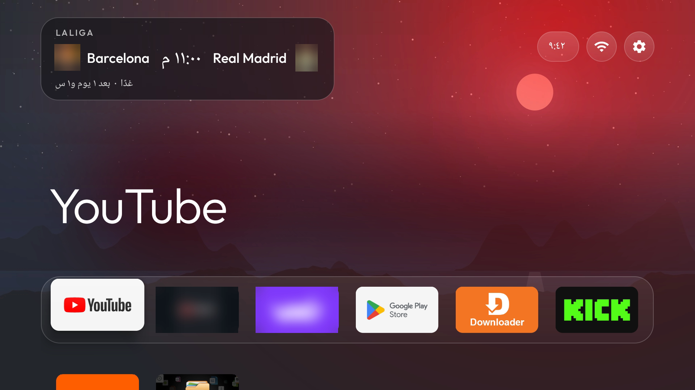

<div align="center">

[**العربية** (الصفحة الرئيسية)](README.md) · English below

# Android TV, Apple TV style

**Clone it. Open it in Claude Code. Answer a few questions. Claude does the rest.**

A faster, cleaner home screen for your Android TV or Google TV, with an Apple TV look and a live football card. Built on [CleanYourTV](https://github.com/Gathin23/cleanyourtv).

[](LICENSE)
[](#what-you-need)
[](https://claude.com/claude-code)
[](README.md)



</div>

I tried the TV-cleanup trend on my own Xiaomi Mi TV Stick, then went further: an Apple TV style home, a football card with goal alerts, and a flow that asks for your taste first. This repo is everything I used: the prompt, the code, the scripts.

## Quick start

```bash
git clone https://github.com/Dr-Zaid/android-tv-apple-style.git
cd android-tv-apple-style
claude        # open Claude Code here, then say: start
```

1. Claude asks what it needs **once**: your TV, your dock apps, the look you want, your team (or none), and what may be removed.
2. It backs up your TV, cleans it, installs the new home and checks the Home button on your real remote.
3. It closes the debugging door and hands you a restore script.

That is the whole job. It is the quick flow: no benchmarks and no long test runs.

> Prefer to paste? Open Claude Code in this folder and paste [`PROMPT.md`](PROMPT.md).

## Tell Claude your taste

You are not stuck with my design. When Claude asks about the look, answer in your own words: "darker and calmer", "a blue sunset wallpaper, 5 columns, no clock", "flat dock, big icons". Claude maps your taste onto what the kit really controls (the wallpaper, the columns, the glass dock, the focus animation, the header, the match card) and tells you plainly if something is not possible.

## What you get

- **An Apple TV style home:** a full-screen picture, a glass dock, the focused app grows and lifts with a soft shadow, a small clock and round buttons.
- **A cleaner TV:** manufacturer telemetry and ad services are disabled, never uninstalled.
- **A live football card:** your team's next match with a countdown, the live score, and a goal banner over any app. Optional.
- **A restore script:** one command puts everything back.

## My results

Measured on my Xiaomi Mi TV Stick (Android TV 9, 1 GB RAM) with the full prompt:

| | Before | After |
|---|---|---|
| Moving between apps | 638 ms | **338 ms** |
| Remote button response | 21 ms | 21 ms |
| Home stutter | 0% | 0.5% |
| Crashes in 2,000 random presses | | **0** |
| First open of YouTube | 5.4 s | **3.6 s** |
| Free RAM after cleanup | 288 MB | **451 MB** |

To be honest: the new home opens a little slower than the stock one (0.82 s instead of 0.66 s) because of the background picture, and app open times vary from run to run on a 1 GB device. Your TV will differ. Want the same numbers for your TV? Use [`PROMPT-FULL.md`](PROMPT-FULL.md).

## What you need

- **Claude Code** with a Claude **Pro** or **Max** plan. The model and effort are your choice; I used Opus on High.
- A **Mac or Windows** computer on the **same Wi-Fi** as the TV, with about 3 GB free. Claude installs Python, Java and the Android SDK for you (all free).
- An **Android TV or Google TV** (Android 8 or newer): Xiaomi, TCL, Hisense (Android), Sony, Nvidia Shield and most others.
- **Not supported:** Samsung (Tizen), LG (webOS), Roku, Vizio, Hisense VIDAA and Amazon Fire TV.
- Your **remote in hand**: Claude will ask you to press buttons and accept prompts.

<details>
<summary><b>Turn on ADB on your TV (2 minutes)</b></summary>

ADB is the door that lets the computer talk to the TV over Wi-Fi.

**Android TV (like the Mi TV Stick):**
1. Settings, Device Preferences, About.
2. Press OK on **Build** seven times until it says "You are now a developer".
3. Back to Device Preferences, **Developer options**, turn on **USB debugging** (and **Network debugging** if you see it).

**Google TV:**
1. Settings, System, About, press **Android TV OS build** seven times.
2. Back to System, **Developer options**, turn on **USB debugging**. If that does not work, Claude will ask for **Wireless debugging** and its pairing code.

When Claude first connects, the TV shows **"Allow USB debugging?"**: tick **Always allow** and press OK. On a Mac you may also see a **Local Network** prompt: allow it.

</details>

## When it is done

Close the door you opened. Port 5555 is open to anything on your network while debugging is on:

1. Developer options, **Revoke USB debugging authorisations**.
2. Switch off the **Developer options master switch** at the top (on the Mi TV Stick, turning off USB debugging alone is not enough).
3. Restart, and let Claude confirm that port 5555 refuses connections.

## Good to know

- Claude makes a backup and a restore script before it changes anything. Keep them.
- Packages are disabled, not removed. Firmware updates can switch some back on.
- It does not remove YouTube ads.
- The football card uses an unofficial ESPN feed. If ESPN changes it, the card keeps the last match until it is fixed.
- This is personal-project software, provided as is. See the [license](LICENSE).

## What is inside

| Path | What it is |
|---|---|
| [`PROMPT.md`](PROMPT.md) | The quick prompt: asks your taste, then does the work |
| [`PROMPT-FULL.md`](PROMPT-FULL.md) | The full tested prompt, with speed tests and before/after numbers |
| [`CLAUDE.md`](CLAUDE.md) | Tells Claude Code what to do when you open this folder |
| [`kit/launcher-apple-tv.patch`](kit/launcher-apple-tv.patch) | The Apple TV look, as a patch on CleanYourTV's launcher |
| [`kit/madrid-live/`](kit/madrid-live) | A small companion app: live team card data and the goal banner |
| [`kit/tools/`](kit/tools) | Speed and smoothness tools, and the install script |
| [`kit/theme-apple/`](kit/theme-apple) | Theme settings (wallpaper slot, 6 columns) |
| [`kit/examples/`](kit/examples) | The cleanup list I used on the Mi TV Stick |
| [`screenshots/`](screenshots) | Photos from the stick |

## If this saved you time

Please **star the repo**: it helps other people find it. And star [CleanYourTV](https://github.com/Gathin23/cleanyourtv) too, the project this is built on. If you share it, tell me how it went on your TV.

## Help others: send a device report

Did it work on your TV? [Open a device report](../../issues/new?template=device-report.yml) with the brand, the model and how it went. It helps the next person.

## Credits

- Built on **[CleanYourTV](https://github.com/Gathin23/cleanyourtv)** by Gathin (MIT). Please star the original: it is the foundation of this whole project. Its license notice is in [`THIRD_PARTY_NOTICES.md`](THIRD_PARTY_NOTICES.md).
- Apple TV look, football card, tools and the fast flow: **Zaid Fouad** ([@Dr-Zaid](https://github.com/Dr-Zaid)).
- Apple, Xiaomi, Google, ESPN, Real Madrid and other names belong to their owners. This project is independent and not affiliated with any of them. Crests and app logos are not included.

## Learn to build things like this

Everything here was built with Claude Code, and I did not start as a programmer. If you want to learn how to do the same, you can sign up for free at **[Zaid AI Class](https://zaidaiclass.com)**: there is a lot more coming.

## License

[MIT](LICENSE) for my parts. CleanYourTV and the other third-party items keep their own licenses: see [`THIRD_PARTY_NOTICES.md`](THIRD_PARTY_NOTICES.md).
